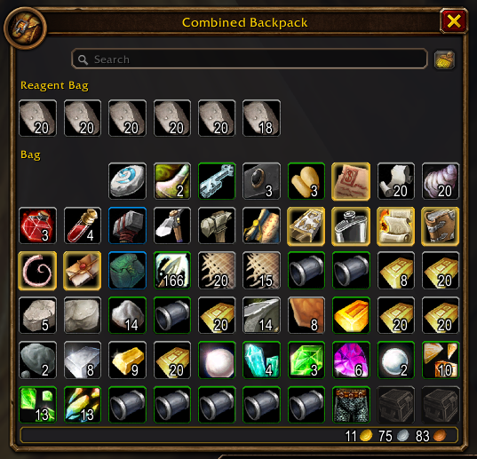

# Reagent In Bags

World of Warcraft addon that shows the reagent bag slots inside the combined
backpack window and hides the separate reagent bag window, so the normal bag
key opens everything in one place.



- Panel grows with the size of the equipped reagent bag.
- `/rbag` (or the addon menu entry next to the minimap) opens the settings:
  panel colour (hue wheel), style (Blizzard / tinted), titles on/off and
  slot alignment (right like the bag grid, or left) and placement (under the
  search box, or below the bag slots above the money bar).
- `/rbag top` / `/rbag bottom` switch the placement directly.
- `/rbag debug` prints how the bag frame is built (for bug reports).

## Install

Put this repository's contents in `Interface/AddOns/ReagentInBags`.

## Layout

```
ReagentInBags.toc        load order + addon-menu entry
Core/Constants.lua       sizes, defaults
Core/Util.lua            small frame helpers
Core/Config.lua          saved settings, setters, change notifications
Core/ItemShift.lua       moves Blizzard's item buttons up (bottom placement)
Core/Layout.lua          window sizing, panel + slot placement
Core/Debug.lua           /rbag debug
Core/SlashCommands.lua   /rbag
Core/Main.lua            entry point: login, events, wiring
UI/Panel.lua             the reagent panel frame + styling
UI/SlotButtons.lua       the reagent slot buttons
UI/Options.lua           settings panel + colour picker
Integration/BagHooks.lua hooks into Blizzard's bag code
Integration/AddonCompartment.lua  addon menu entry
```

Modules share state through the addon namespace (`local _, ns = ...`); the
only globals are the saved variable, the slash command and the addon
menu callbacks. Lint with `luacheck .`, format with `stylua .`.

## Releases

Publishing a GitHub release runs `.github/workflows/release.yml`, which builds
`ReagentInBags.zip` with the [BigWigs packager](https://github.com/BigWigsMods/packager)
(layout in `.pkgmeta`) and attaches it to the release. The same zip works for
manual installs (unzip into `Interface/AddOns`) and for CurseForge. To upload
to CurseForge automatically, add the `CF_API_KEY` repository secret and an
`## X-Curse-Project-ID: <id>` line to the `.toc`.
